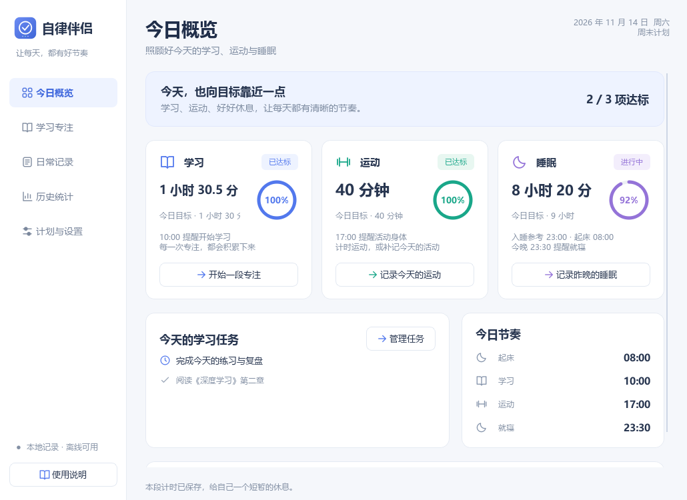
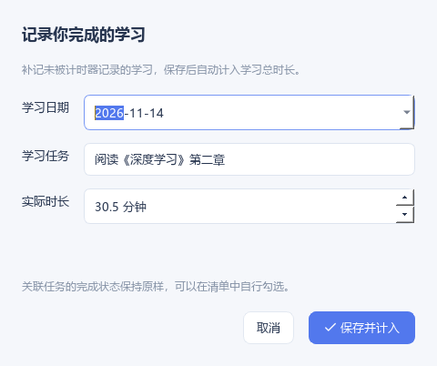

# Self-Discipline Companion

[简体中文](README.md) · English

An offline Windows study timer and daily habit tracker. Start a focus session at your desk, log time spent studying on paper, and see the combined total alongside exercise and sleep. **The app interface is in Simplified Chinese.** The steps below include the labels you’ll see.

**[Download the portable Windows x64 build](https://github.com/troulierkilian-blip/self-discipline-companion/releases/latest)** · Under **Assets**, choose the `.exe` to run directly or the `.zip` for the same app with the Chinese manual. Supports Windows 10 (1809 or newer) and Windows 11 x64. No Python installation is needed.



## Log time away from your computer

1. On first launch, set separate weekday and weekend goals, reminder times, bedtime and wake-up time.
2. Suppose you spent 30.5 minutes reviewing a chapter on paper. Open **学习专注 → 补记学习** (Focus → Log study time), select the date, choose a task or enter a name, and enter `30.5`. Click **保存并计入** (Save and add to total).
3. Open **今日概览** (Today). If you already had a 25-minute timed session that day, the total is now **55.5 minutes**. **日常记录 → 学习记录** (Daily records → Study log) shows timed and manual entries separately. You can also log a past date there.



## Track exercise, sleep and weekly trends

- **Exercise** · Start a timer under **日常记录** (Daily records) or enter minutes after a walk.
- **Sleep** · Use **准备睡觉** (Going to bed) and **已经起床** (I’m up), then check the times. Each night is recorded under the date you woke up.
- **Review** · Open **历史统计** (History) for 7-day and 30-day trends, days on target and a CSV export you can open in Excel.

Records stay in `%LOCALAPPDATA%\自律伴侣`. Use **计划与设置** (Plan & settings) to back up or restore them. When the system tray is available, closing the window keeps reminders running. Before upgrading, right-click the tray icon and choose **退出** (Quit). See the [full user guide in Chinese](使用说明.md).

## Run or build from source

On Windows x64, install Python 3.10 x64 and open PowerShell in the repository root.

```powershell
python -m venv .venv
.\.venv\Scripts\python.exe -m pip install -r requirements-lock.txt
.\.venv\Scripts\python.exe main.py
```

To test and package the app, run `powershell -ExecutionPolicy Bypass -File .\build.ps1`. The script runs core and UI tests, generates `dist\自律伴侣.exe` and verifies the packaged executable. See the [release test report in Chinese](验收报告.md) and [third-party notices](THIRD_PARTY_NOTICES.md).

If the app helps you, the [Chinese README includes Alipay and WeChat support options](README.md#支持项目).
