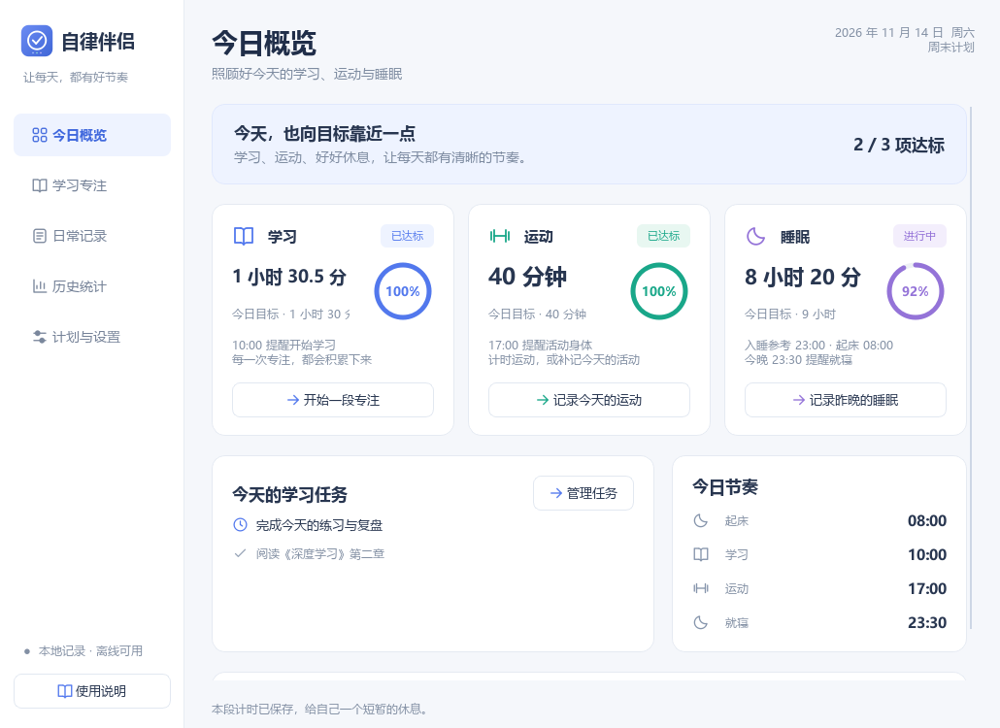
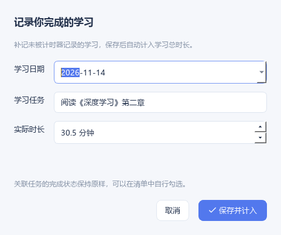

# 自律伴侣 · Windows 离线学习计时与作息记录

简体中文 · [English](README.en.md)

在电脑前学习时开专注计时器，合上电脑做题时也可以事后补记。两种时长都会计入当天的学习目标；同一页还能看到今天运动了多久、昨晚睡了多久。

**[下载 Windows x64 免安装版](https://github.com/troulierkilian-blip/self-discipline-companion/releases/latest)** · 在 **Assets** 中选 `.exe` 直接运行，或选含中文说明的 `.zip`。支持 Windows 10（1809 及以上）和 Windows 11 x64，无需安装 Python。



## 忘了开计时器，怎么补上这段学习？

1. 第一次打开软件时，分别设好工作日与周末的学习、运动目标和作息时间。
2. 比如你在纸上复习了 30.5 分钟，打开 **学习专注 → 补记学习**，选学习日期，选择已有任务或填写名称，输入 `30.5`，点 **保存并计入**。也可以在 **日常记录 → 学习记录** 补记过去某一天。
3. 回到 **今日概览** 看当天合计。比如同一天已经计时 25 分钟，再补记 30.5 分钟，学习总时长就是 **55.5 分钟**。学习记录里还能分清哪段是计时、哪段是补记。



## 运动、睡眠和每周复盘

- **运动** · 在「日常记录」选择运动类型后开始计时，也可以散步回来再填写实际分钟数。
- **睡眠** · 睡前点「准备睡觉」，次日点「已经起床」，确认或修正时间。睡眠归入起床当天。
- **复盘** · 在「历史统计」看近 7 天或 30 天的趋势、各项目标达标的天数，或导出 CSV 用 Excel 查看。

记录保存在本机的 `%LOCALAPPDATA%\自律伴侣`。在「计划与设置」可以备份和恢复。系统托盘可用时，关掉窗口后提醒继续运行；升级前请右键托盘图标选择「退出」，再打开新版。更多操作见[完整使用说明](使用说明.md)。

## 从源码构建

在 Windows x64 上安装 Python 3.10 x64，在项目根目录打开 PowerShell，运行以下命令。

```powershell
python -m venv .venv
.\.venv\Scripts\python.exe -m pip install -r requirements-lock.txt
powershell -ExecutionPolicy Bypass -File .\build.ps1
```

构建脚本会运行核心与界面测试，生成 `dist\自律伴侣.exe`，并验证打包后的程序。只想从源码启动时，安装依赖后运行 `.\.venv\Scripts\python.exe main.py`。

本版测试环境、结果和验证范围见[验收报告](验收报告.md)。Python、Qt 和其他依赖的许可见[第三方软件声明](THIRD_PARTY_NOTICES.md)。

## 支持项目

如果「自律伴侣」帮到了你，欢迎通过支付宝或微信扫码打赏。感谢你的支持！

| 支付宝 | 微信 |
| :---: | :---: |
|  |  |
